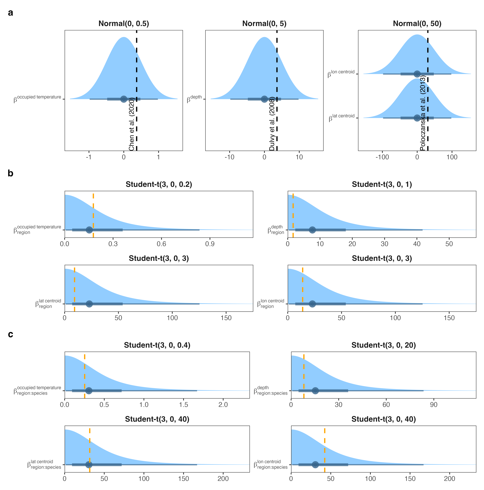

# Bayesian trend analysis

---

This README accompanies the scripts in the `bayesian_trends/` directory. We use a hierarchical Bayesian framework to estimate temporal trends in latitudinal and longitudinal centroids, depth centroid, and mean occupied bottom temperature. The models are fitted using the `brms` package, which interfaces with Stan for Bayesian inference.
We propagate standard errors from the spatiotemporal modeling into the trend analysis to account for observation-level uncertainty. The hierarchical structure allows us to estimate global, regional, and species-level trends within a single unified model.

**Data locations:**

- Input data: `R/data/processed/derived_quantities_sdm.rds`

- Fitted models: `R/03_bayesian_trends/fitted/` (`m_stud.rds`, and `m_mvn.rds` for the Gaussian comparison)

- Estimated trends: `R/data/processed/bayesian_global_trends.rds`, `bayesian_region_trends.rds`, `bayesian_species_trends.rds`

- LaTeX macros: `output/values/bayesian_trend_analysis/`

the main scripts are:

### `01_fit_bayesian_trend.R`

<details>
  <summary>Click here to expand</summary>

- Fits hierarchical Bayesian models for all response variables using a **Student-t likelihood**, robust to extreme values.
- Includes:
  - **Global slope** for time (decade effect)
  - **Region-level deviations**
  - **Species-level deviations nested within region**
- The term `|ID|gr(region:species, by = region)` forces slopes to be correlated within regions.
- Each response variable is modeled with its standard error (`se(...)`) from the spatiotemporal model.
- Example syntax:

```r
brm(
  formula = bf(
    cog_y_c | se(cog_y_se, sigma = TRUE) ~ 0 + year_c + 
      (0 + year_c | region) + 
      (0 + year_c | ID | gr(region:species, by = region))
  ) +
  bf(...) + ... # other responses
  set_rescor(FALSE),
  data = data,
  family = student()
)
```
 - Centered response variables and time predictor per species–region combination so that slopes represent deviations from species–region mean.
 - Time rescaled to decades for interpretable slope units (change per decade).

</details>

### `02_model_diagnostics.R`

-	Performs posterior predictive checks (PPCs) to evaluate fit.
- Checks convergence using:
	-	$\hat{R}$
	-	Bulk and tail effective sample size (ESS)
	-	Divergent transitions
	-	Visualizes diagnostics and confirms good enough sampling.


### `03_prior_diagnostics.R`
  
- Plot priors for global, regional, and species-level slopes.
- Compares priors against literature and empirical distributions from the data.



### `04_plot_model_slopes.R`

-	Generates figures of estimated slopes for species and regions.


### `05_create_macro_latex.R`

- Automates LaTeX Output
	-	Extracts posterior summaries.
	-	Produces LaTeX macros automatically for manuscript reporting.
Code is from Sean.

### `06_show_shrinkage.r`

- Compares species-level slopes from the hierarchical model with independent per-population `lm()` fits, to show partial pooling.
- Figure: `output/figures/supp/shrinkage_supp.png`

### `07_visualize_correlations.r`

- Extracts the region-specific correlations between species-level slopes (`cor_region:species__*`) from `m_stud.rds`.
- Figure: `output/figures/supp/corr_shifts_supp.png`, macros: `output/values/rho_values.tex`

### `08_static_vs_dynamic_occupied_temp.R`

- Separates the two sources of change in mean occupied bottom temperature: redistribution of biomass vs. warming of the water a population already occupies.
- Refits the trend with the density field held constant over time (`thermal_niche_constant_density` from `02_derive_quantities.R`) and compares it to the realized trend.
- Figure: `output/figures/supp/static_vs_dynamic_niche.png`

### `09_warming_group_comparison.r`

- Splits regions into warming (BC, USWC, NEUS-SS, NS, BAL) and non-warming (EBS, GOA, GOM, BS, CBS, NIC) based on the bottom-temperature trend over the survey period, and contrasts group-mean slopes draw by draw.
- Also correlates region-level median slopes with the regional bottom-temperature trend.
- Figure: `output/figures/supp/warming_group_slopes.png`, macros: `warming_group_slopes.tex` and `temp_correlations.tex`
